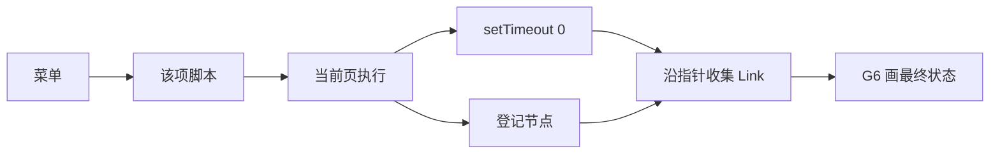

# 信号内部结构可视化

上一轮三问按「是」记下：`setTimeout(draw, 0)` 等微任务排空后再画，新执行会取消上一次未完成的取图；按种类分列、按创建顺序排布，指针不参与布局；运行时错误保留已登记对象，语法错误清空图。下面是已经收口的共同结论。确认之后才改代码。

## 已经定下的产品

- 图里的节点是该库内存里的内部对象，边是这些对象上的真实指针，字段名保持原样。
- 应用壳保持现在的无框架 Vite+ 页面，入口是 [index.html](index.html) 加载的 `src/main.ts`。不引入 Vue、React、Solid 或 Svelte。
- 图引擎用 G6。可拖拽、可缩放。重跑不重置视口。
- 菜单四项：`alien-signals`、`@preact/signals-core`、`solid-js` 的 signal runtime、Angular 的 signals 原语。Svelte 先不做。Vue 的 `@vue/reactivity` 以后另立，不把 `alien-signals` 标成 Vue。
- 第一刀只打通 `alien-signals`。另外三项菜单在，点进去画布显示「源码还没接入」，脚本不跑。源码还没放进仓库时，`alien-signals` 也显示这句。
- 每项菜单有一份自己的脚本，注入该库函数名，脚本里不写 `import`。改动留在该项里，刷新后回到示例。`alien-signals` 的示例是 `signal` / `computed` / `effect`，读取是 `count()`，写入是 `count(1)`。
- 停顿后在当前页面自动重跑，不用 Web Worker。传播函数不改，不设步数上限。`while (true)` 会卡住标签页，刷新恢复。`console.log` 进开发者工具，页面上不另做控制台。
- 不按步取样。脚本函数返回后用 `setTimeout(draw, 0)` 再取最终状态。这一轮直接或间接排上的微任务会先跑完。脚本里的 `setTimeout` 和 `requestAnimationFrame` 不纳入这次取图。
- 读得到的对象不改源码。读不到的只加暴露口。`link`、`propagate`、`flush` 保持上游原样。
- 每个内部对象一张卡片，包括 `Link`。每条指针一条带字段名的边。卡片正文只留种类、当前值、`flags`、`version` 这类标量。函数字段只标「有函数」。
- 同一类对象一列，列顺序固定为 signal、computed、effect、Link。列内按创建顺序从上到下。结构不变时同一序号留在原格；有增删就整列重排。`Link` 的稳定编号是它连接的两端。

## 一次执行怎么走

注入的 `signal`、`computed`、`effect` 调用原实现，并把节点放进这一轮的列表。脚本局部变量在函数返回后就消失，图不靠脚本的返回值。重跑或切走菜单时，先取消上一次还没画出的取图，再调用上一轮登记的停止函数，然后跑新脚本。

`alien-signals` 的 `signal()` 和 `computed()` 返回的是 `bind(node)`，依赖链表在被 bind 的那个 node 上。暴露口只在这三个工厂函数旁把 node 交出来。`Link` 仍由原来的 `link()` 创建，取图时从已登记节点的 `deps`、`depsTail`、`subs`、`subsTail` 以及 `Link` 上的 `dep`、`sub`、`prevDep`、`nextDep`、`prevSub`、`nextSub` 走出来。同一轮里按对象身份去重。

语法错误发生在执行之前，立刻清空图并显示在脚本区。运行时抛错也显示在脚本区，并走同一次延时，画出抛错前已经登记的对象。

## 实现落点

源码由你放进 `vendor/alien-signals`。页面代码放在 `src/`：

- 壳：左栏菜单、上方 G6 画布、下方脚本框，从 [index.html](index.html) 的 `#app` 挂上去。
- 内核适配：统一的「示例脚本、注入函数、登记、停止、是否已接入」。
- `alien-signals` 适配：包住三个工厂做登记；取图时再走指针。不改传播。
- 另外三项适配先返回未接入。
- 把结论写回 [README.md](README.md)，替换现在的草稿说明。

GitHub Pages 部署留到这张图在本地跑通之后。
